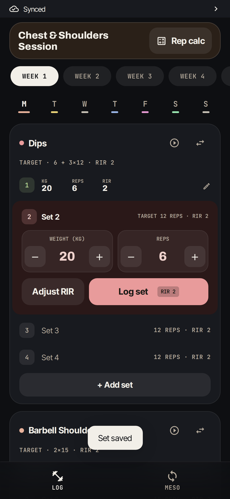
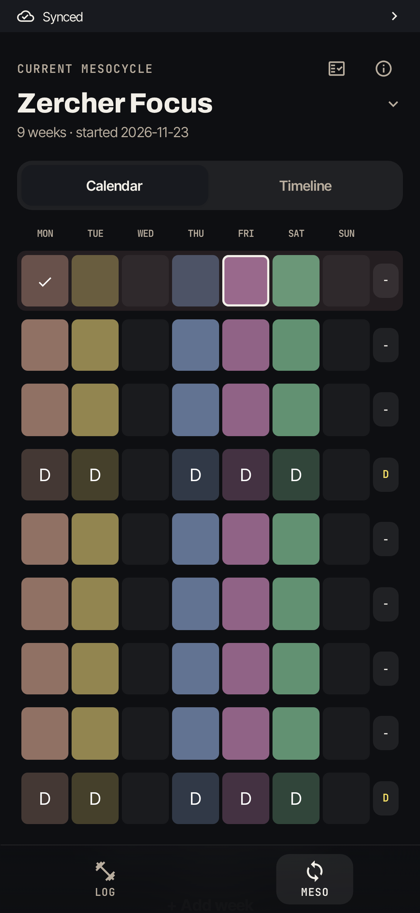
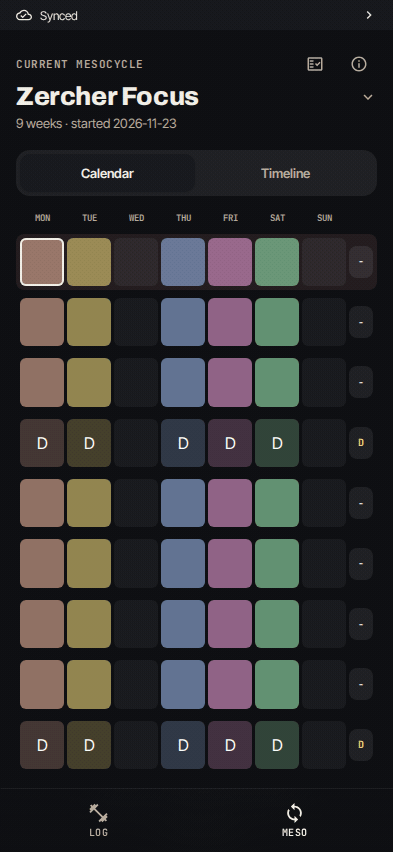

# Strength Guru

Strength Guru is a private, self-hosted strength tracker built for your phone. Plan training blocks, log sets at the gym, and use reps in reserve (RIR) to guide progression.

| Workout log | Mesocycle calendar |
| --- | --- |
|  |  |

*Screenshots from an emulated iPhone 16.*

- Log sets offline and sync them when you reconnect.
- Plan multiweek blocks with per-set targets and deload weeks.
- Generate programs with optional AI inference on your own server.

## Workflow demo

Pick a session from the calendar, log a set, and see the session marked as started.

## Quick start

Set up an OpenID Connect client and configure Docker Compose using the self-hosting guide. The deployment owner signs in first and sends single-use invitations to the people who need an account.

The guide also covers private HTTPS access, iPhone Home Screen installation, and NVIDIA inference. [Self-hosting guide](docs/self-hosting.md)
